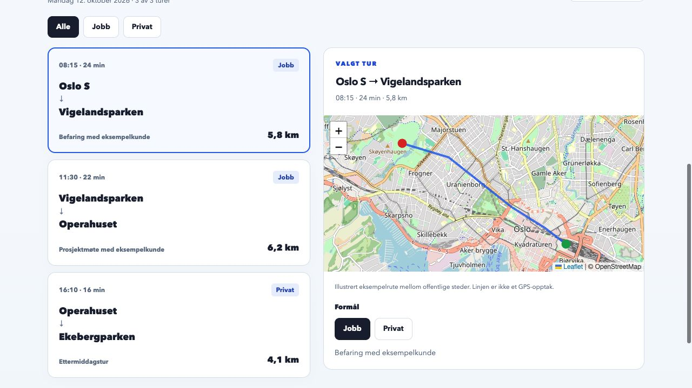

# Nguyen Chu

**Mobile & Frontend Developer** · React Native · TypeScript · React

I build and maintain mobile and web products that connect user experiences with real services and devices. I have **7+ years of production experience**, including iOS and Android apps used by tens of thousands of customers across Europe and Canada.

**[Portfolio](https://nguyenchu.com/)** · **[Try Kjørebok — no account needed](https://kjorebok.nguyenchu.com/demo)** · **[Email](mailto:nguyen.chu@hotmail.com)**

Currently open to **mobile, frontend, and product-focused software developer** roles.

## Production experience

- Built, maintained, released, and supported customer-facing mobile apps end to end
- Integrated REST, GraphQL, Firebase, Bluetooth, and Wi-Fi
- Debugged practical problems across apps, services, and devices
- Worked with product, design, embedded, and backend teams, including CI/CD and app-store releases

## Selected personal projects

### [Kjørebok](https://github.com/nguyenchu/kjorebok)

A driving logbook with an Expo mobile app, a Next.js web app, and a Fastify API backed by PostgreSQL.

- **Problem:** turn noisy GPS points into a usable trip history, maps, and reports.
- **Architecture:** shared domain types connect web, mobile, and API; input validation happens at the API boundary.
- **Tradeoff:** shared types reduce duplication, while background location, permissions, and battery behavior still require platform-specific work and device testing.
- **Code to explore:** [GPS processing](https://github.com/nguyenchu/kjorebok/tree/main/apps/api/src/lib/track), [shared domain types](https://github.com/nguyenchu/kjorebok/tree/main/packages/shared/src), and [CI](https://github.com/nguyenchu/kjorebok/blob/main/.github/workflows/ci.yml).

**[Interactive demo](https://kjorebok.nguyenchu.com/demo)** · **[Project walkthrough](https://nguyenchu.com/prosjekter/kjorebok.html)**

The demo uses fictional trips. Explore maps, switch trip purpose, filter the log, and export CSV without registering. GPS recording and API-backed reporting are outside the demo.

### [Matkupp / melk-og-brod](https://github.com/nguyenchu/melk-og-brod)

A grocery-price app that compares current prices with each store's own 90-day price history.

- **Problem:** distinguish a historical price drop from the lowest price across stores, and compare different package sizes fairly.
- **Architecture:** a separate data pipeline prepares a static catalog; the Expo app caches and filters it locally. The upstream API token stays out of the app bundle.
- **Tradeoff:** a static catalog simplifies delivery, but freshness depends on successful synchronization and the coverage of the source data.
- **Code to explore:** [price normalization](https://github.com/nguyenchu/melk-og-brod/blob/main/lib/pricing.ts), [pricing tests](https://github.com/nguyenchu/melk-og-brod/blob/main/lib/pricing.test.ts), and [data pipeline](https://github.com/nguyenchu/melk-og-brod/tree/main/scripts/kassal-sync).

**[Project walkthrough](https://nguyenchu.com/prosjekter/matkupp.html)**

### More projects

- **[Aetherfall](https://github.com/nguyenchu/aetherfall)** — a story-driven roguelite built with Phaser, TypeScript, Vite, and Capacitor.
- **[QuickFit](https://github.com/nguyenchu/quickfit)** — a React Native / Expo workout companion with structured programs and spoken guidance.

## Engineering approach

I weigh platform requirements, team skills, integrations, testing, and long-term maintenance when choosing between cross-platform and native development. AI-assisted implementation is one input to that decision; the product requirements still determine the fit.

## Core technologies

**Mobile & frontend:** React Native, Expo, React, Next.js, TypeScript, JavaScript  
**Integration:** REST, GraphQL, Firebase, Bluetooth, Wi-Fi  
**Backend:** Node.js, Fastify, Prisma, PostgreSQL  
**Delivery:** Git, GitHub Actions, CI/CD, Docker, pnpm, Vite
